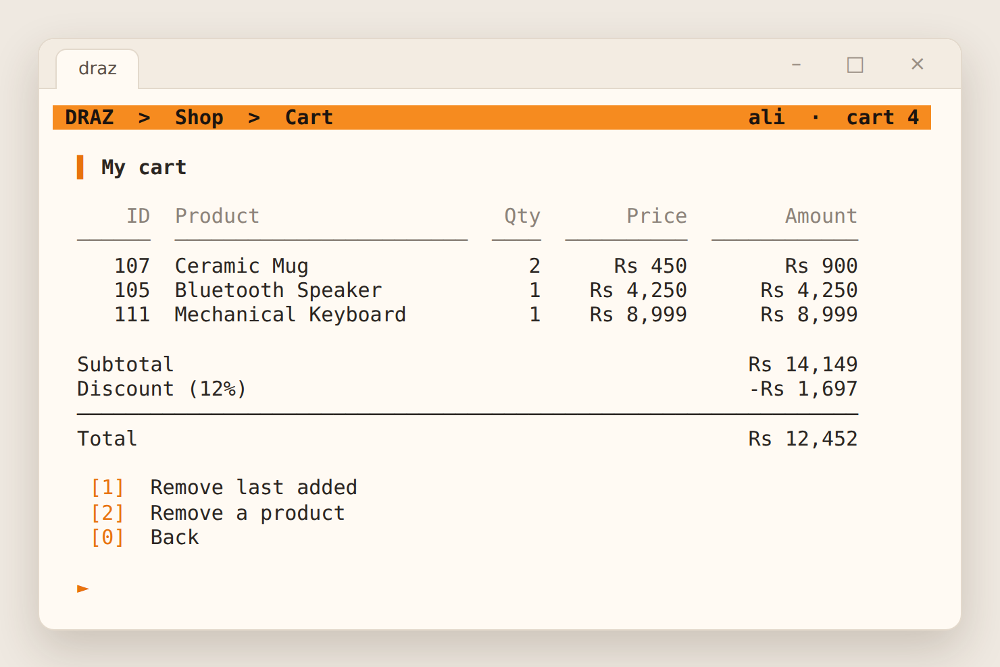
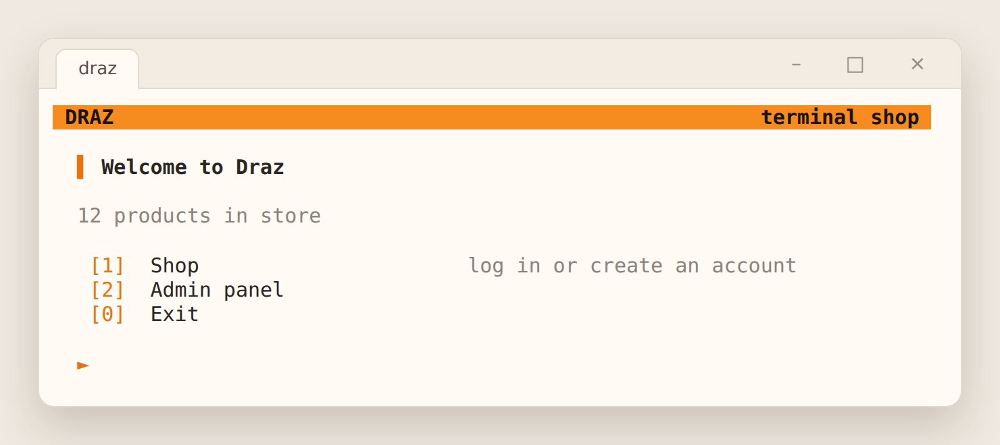
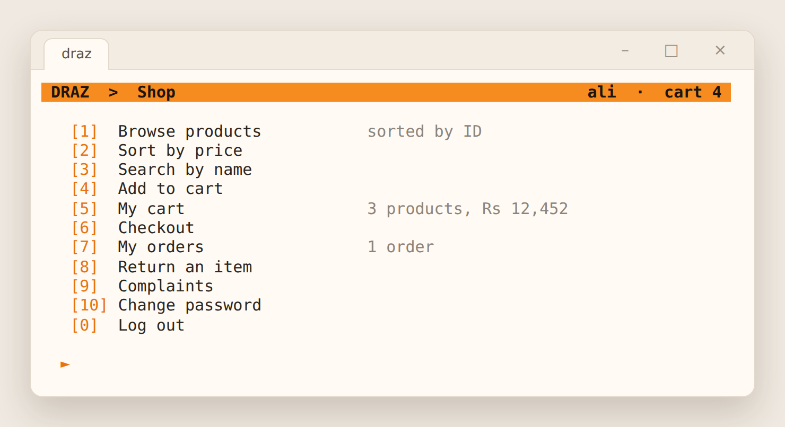
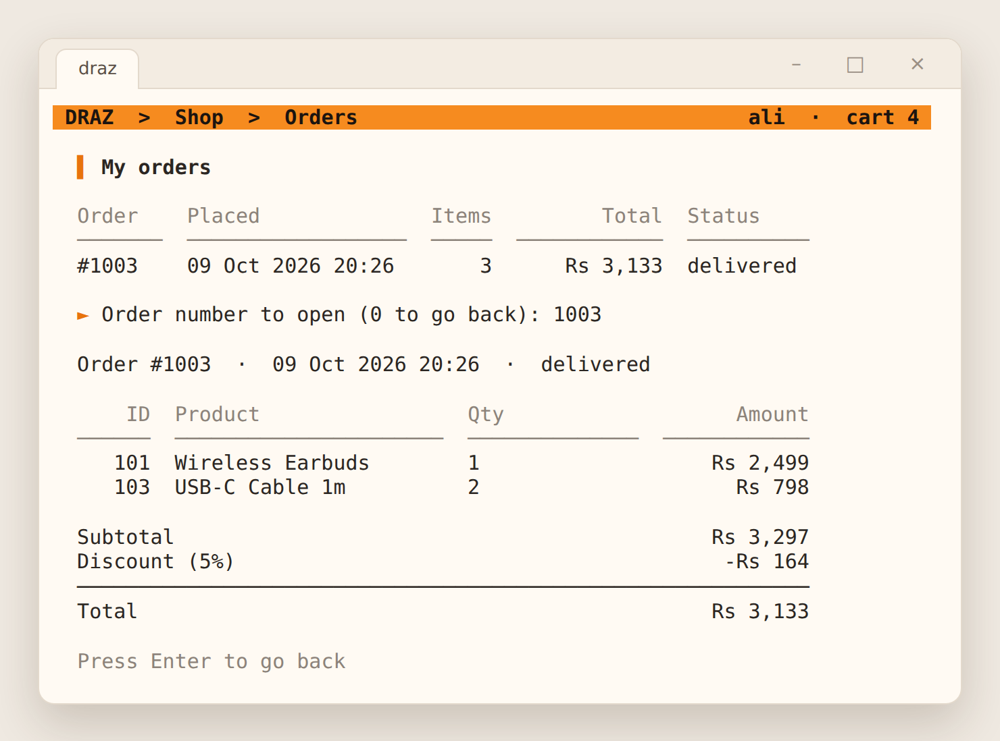
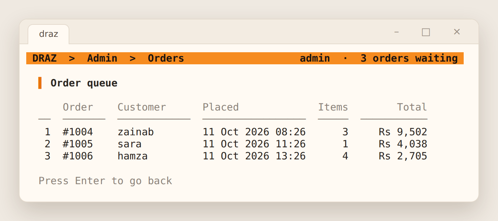
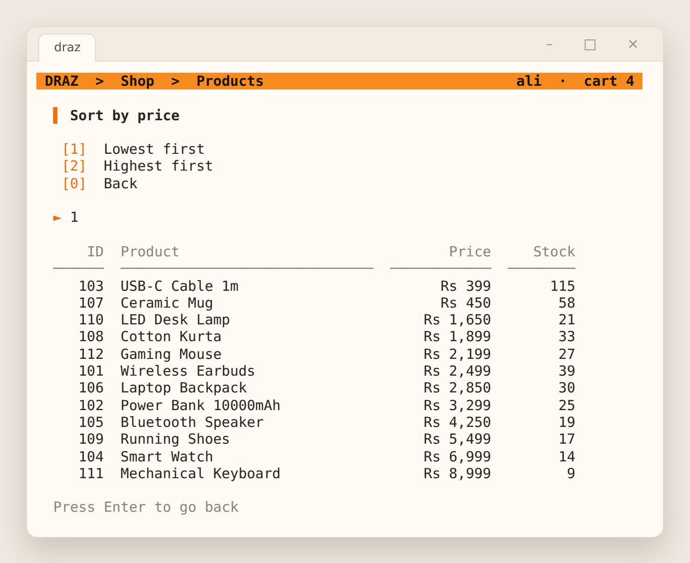

# Draz

A shopping app for the terminal, written in C++17, inspired by the Daraz online store. Customers browse products, fill a cart, check out and track their orders. The admin manages products and processes orders. It started as my university Data Structures and Algorithms course project, and the data structures behind it are written by hand: a binary search tree, a stack, a queue and merge sort.

It builds and is tested on Windows, Linux and macOS. This is a student project and is not affiliated with Daraz.



## Features

**Customers**
- Browse products, sort them by price, or search by name
- A personal cart that is kept between sessions. "Remove last added" undoes the most recent item.
- Checkout with tiered discounts, from 5% on Rs 1,000 up to 20% on Rs 20,000 or more
- Order history with a receipt for every order
- Return items from delivered orders, with a refund that accounts for the discount
- Write complaints and see whether they were resolved

**Admin**
- Add, edit, delete and search products
- An order queue: orders are processed in the order they were placed
- Complaints, newest first, which can be marked resolved
- Customer list with order counts and amount spent
- Store stats: stock, stock value, waiting orders and open complaints
- Reset a customer's forgotten password

## DSA and OOP design

Every data structure lives in [`include/draz/ds/`](include/draz/ds) as a reusable template with its own tests.

- **Binary search tree** (`bst.h`) holds every product, keyed by product ID.
  - Finding, adding and removing a product follows one path from the root, instead of scanning the whole list.
  - Deleting a node with two children moves up its in-order successor.
  - An in-order traversal lists products sorted by ID.
  - Products are saved in ID order, which would build a long chain. So after loading, the tree is rebuilt balanced, middle key first.
- **Stack** (`stack.h`): each customer's cart.
  - "Remove last added" is a pop.
  - Complaints are also kept on a stack, so the newest one is shown first.
- **Queue** (`queue.h`): placed orders wait here. The admin always processes the oldest order first.
- **Merge sort** (`sort.h`): used for "sort by price". It runs bottom-up (no recursion) and is stable, so products with the same price keep their ID order.
- **No memory leaks:**
  - Nodes are owned by `std::unique_ptr`, so they are freed automatically.
  - Long stacks and queues are freed one node at a time, which avoids overflowing the call stack.
  - Tests run with AddressSanitizer.
- **Inheritance and polymorphism:**
  - `Admin` and `Customer` inherit from an abstract `Account` class.
  - `AdminScreen` and `CustomerScreen` inherit from `Screen`, which runs the shared menu loop and calls each one's virtual `path()`, `status()`, `items()` and `handle()`.
- **Encapsulation:** all store data lives inside the `Store` class and changes only through its methods, which enforce every rule. The rules are tested without the screens.

## Security

- **Passwords:** stored as PBKDF2-HMAC-SHA256 hashes with 600,000 iterations and a random 16-byte salt per account. They are never stored or shown in plain text.
- **Login lockout:** 5 wrong passwords lock an account for 5 minutes, and the lock survives a restart.
- **No account guessing:** an unknown username gets the same message and takes the same time as a wrong password. Hashes are compared in constant time.
- **First-run admin:** the admin account is created on first run. There is no built-in admin password.
- **Roles enforced in the core:** only the admin can change products, process orders, resolve complaints or reset passwords. Customers can only see and return their own orders.
- **Safe input and files:**
  - Every input is checked: IDs, prices, stock, quantities, text length.
  - Data files are written to a temporary file and renamed, so a crash can't leave half a file.
  - Damaged lines are skipped instead of trusted.

### Fixed in self-review

Reviewing the original course project, I found and fixed these problems. Each one has a regression test.

- **Plain-text passwords, and "forgot password" printed them** to anyone who typed a username. Passwords are now hashes, and the admin resets forgotten ones.
- **Hardcoded admin login** (`admin` / `1234`).
- **BST delete corrupted products:** deleting a product with two children copied only the successor's ID, so another product took the deleted product's name and price.
- **Changing a product's ID broke the tree:** the key was edited in place, so the product could no longer be found or bought. It is now removed and inserted again.
- **The product count grew every time** it was shown, because it used a `static` counter.
- **One cart for everyone:** a customer who left without checking out left their items in the next customer's cart.
- **Stock disappeared without a sale:** adding to the cart lowered the stock on disk right away, and leaving never gave it back. Stock is now taken only at checkout, and checkout checks it again.
- **Complaints were deleted when viewed and never saved.**
- **"Buying history" only showed the current cart.** Orders are now saved with receipts.
- **Memory leaks:** the queue never freed processed orders, the stack freed only its top node, and its rear pointer was left dangling.
- **Search ignored the tree** and visited every node.
- **The program froze in endless loops:**
  - letters at a number prompt
  - a wrong password, with no way back
  - a product name with a space
  - entering a duplicate ID once while editing a product

## Build and run

You need CMake 3.16 or newer and a C++17 compiler: Visual Studio 2019 or newer, GCC 9 or newer, or Clang 10 or newer. There are no other dependencies.

```bash
cmake -S . -B build
cmake --build build --config Release
```

Then run it:

```bash
./build/draz                # Linux and macOS
build\Release\draz.exe      # Windows (Visual Studio)
```

On the first run it asks you to create the admin account and offers to add 12 sample products. Everything is saved in a `data` folder in the current directory. Use `--data <folder>` to keep it somewhere else.

**Visual Studio:** choose File, Open, Folder, and pick this folder. Use a Release configuration, because password hashing is much slower in Debug builds.

### Tests

```bash
ctest --test-dir build -C Release --output-on-failure
```

There are 45 tests:

- **Data structures:** each one is tested on its own, including 20,000 random BST operations checked against `std::map` and merge sort checked against `std::stable_sort`.
- **Crypto:** checked against the official test vectors.
- **Store rules and old bugs:** every rule and every bug listed above has its own test.

GitHub Actions runs them on Windows, Linux and macOS on every push.

## Screenshots

**Home**



**Shop menu, with the cart total in the header**



**An order receipt**



**The admin's order queue, first in, first out**



**Products sorted by price**



## Project structure

- `include/draz/ds/`: the BST, stack, queue and merge sort
- `include/draz/` and `src/`: the app
  - `store`: accounts, products, carts, orders, returns and complaints, with every rule enforced here
  - `crypto`: SHA-256, HMAC-SHA256, PBKDF2 and secure random bytes
  - `storage`: reads and writes the tab-separated data files
  - `console`: the header bar, menus, tables and safe input
  - `app`: the screens
- `tests/`: the tests

## Limitations

- **Only passwords are protected.** Products, orders and complaints are stored as plain text, so anyone who can open the `data` folder can read or edit them.
- **One program at a time.** The app is meant for one person at a time on one computer. Two copies writing to the same `data` folder at once can overwrite each other's changes.
- **The tree can drift out of balance.** It is rebuilt balanced on every start, but products added during a session can make it taller until the next start. A self-balancing tree, such as an AVL or red-black tree, would keep it short at all times.
- **Home-made crypto code.** SHA-256 and PBKDF2 are written in the project so it has no dependencies, and they are tested against the official vectors. A real store should use a vetted library.

## License

Released under the [MIT License](LICENSE).
